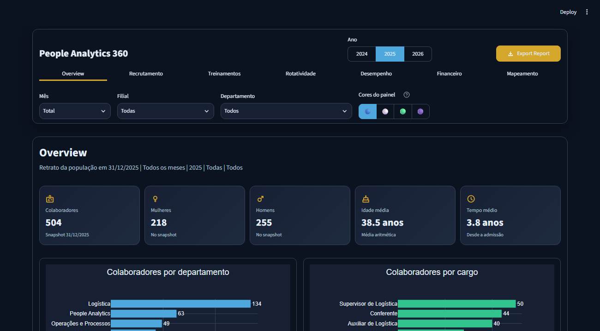
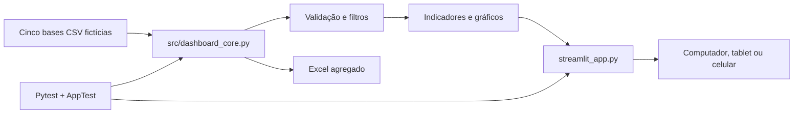

<h1 align="center">People Analytics 360</h1>

<p align="center">
  Dashboard executivo e responsivo de Recursos Humanos desenvolvido com Python e Streamlit.
</p>

<p align="center">
  <a href="https://www.python.org/"></a>
  <a href="https://streamlit.io/"></a>
  
  
  <a href="LICENSE"></a>
</p>

<p align="center">
  <a href="https://people-analytics-360-aloisio.streamlit.app/">
    
  </a>
</p>

<p align="center">
  <a href="https://people-analytics-360-aloisio.streamlit.app/">
    
  </a>
</p>

> **Projeto de portfólio:** esta demonstração utiliza exclusivamente dados fictícios. Nenhum nome, matrícula, salário, avaliação ou atributo de uma pessoa real é publicado no repositório.

> **Privacidade e uso responsável de IA:** dados empresariais reais não devem ser compartilhados com ferramentas de IA públicas ou não autorizadas. Em um ambiente profissional, o uso de IA deve respeitar as políticas de Segurança da Informação, Privacidade e controle de acesso da organização.

> **Última atualização desta documentação:** 13/11/2026.

---

## Índice

1. [Visão geral](#visão-geral)
2. [O problema de negócio](#o-problema-de-negócio)
3. [A solução](#a-solução)
4. [Storytelling: antes e depois](#storytelling-antes-e-depois)
5. [Principais resultados](#principais-resultados)
6. [Evolução do projeto](#evolução-do-projeto)
7. [Funcionalidades](#funcionalidades)
8. [Indicadores e páginas](#indicadores-e-páginas)
9. [Exportação e proteção dos dados](#exportação-e-proteção-dos-dados)
10. [Arquitetura da solução](#arquitetura-da-solução)
11. [Stack tecnológica](#stack-tecnológica)
12. [Estrutura do repositório](#estrutura-do-repositório)
13. [Dados de demonstração](#dados-de-demonstração)
14. [Como executar localmente](#como-executar-localmente)
15. [Testes e qualidade](#testes-e-qualidade)
16. [Publicação no Streamlit](#publicação-no-streamlit)
17. [Decisões técnicas](#decisões-técnicas)
18. [Limitações](#limitações)
19. [Melhorias futuras](#melhorias-futuras)
20. [Desenvolvimento e uso de IA](#desenvolvimento-e-uso-de-ia)
21. [Padrão reutilizável](#padrão-reutilizável)
22. [Autor e licença](#autor-e-licença)

---

## Visão geral

O **People Analytics 360** consolida dados fictícios de quadro de pessoal, movimentações, recrutamento e treinamentos em um dashboard executivo de Recursos Humanos.

A aplicação foi desenvolvida em **Python + Streamlit** e planejada para funcionar em computador, tablet e celular. Ela oferece filtros organizacionais, indicadores, gráficos interativos, quatro temas visuais e exportação segura para Excel.

O projeto integra meu portfólio profissional e demonstra competências iniciais em:

- análise de dados e indicadores de RH;
- estruturação de aplicações Streamlit;
- organização de regras de negócio em módulos Python;
- visualização interativa com Plotly;
- testes automatizados;
- publicação no GitHub e no Streamlit Community Cloud;
- documentação, privacidade e uso responsável de IA.

**Demonstração pública:** [people-analytics-360-aloisio.streamlit.app](https://people-analytics-360-aloisio.streamlit.app/)

## O problema de negócio

Informações de RH costumam ficar distribuídas entre cadastros, históricos mensais, processos seletivos e registros de treinamento. Essa fragmentação dificulta responder com rapidez e consistência a perguntas como:

- Qual é o quadro atual e como ele evoluiu?
- Onde estão concentrados admissões e desligamentos?
- Como estão turnover, absenteísmo e desempenho?
- Quanto foi investido em pessoal e treinamento?
- Como está a composição demográfica da organização?

### Pergunta de negócio

> Como transformar diferentes bases de RH em uma visão executiva única, interativa e segura, capaz de apoiar análises sem expor registros individuais?

## A solução

O projeto reúne cinco bases sintéticas, valida seus contratos, aplica filtros comuns e transforma os registros em indicadores e gráficos organizados em sete páginas temáticas.

```text
Bases fictícias em CSV
    → validação e tratamento em Python
    → filtros e cálculos de People Analytics
    → indicadores e gráficos interativos
    → dashboard responsivo
    → relatório Excel com dados agregados
```

A interface fica em `streamlit_app.py`. A carga dos dados, as validações, os filtros, os cálculos, os gráficos e a exportação ficam concentrados em `src/dashboard_core.py`. Essa separação permite testar as regras sem depender do navegador.

## Storytelling: antes e depois

| Processo | Antes da solução | Com o dashboard |
|---|---|---|
| Consolidação | Bases analisadas separadamente | Fontes reunidas por filtros e períodos comuns |
| Indicadores | Cálculos refeitos manualmente | KPIs calculados de forma padronizada |
| Navegação | Consultas em arquivos diferentes | Sete visões temáticas em uma aplicação |
| Comparação | Recortes difíceis de reproduzir | Filtros por ano, mês, filial e departamento |
| Apresentação | Gráficos preparados individualmente | Painel executivo com quatro temas visuais |
| Mobilidade | Visualização concentrada no computador | Layout adaptado para computador, tablet e celular |
| Exportação | Risco de levar registros individuais | Excel construído somente com tabelas agregadas |
| Qualidade | Conferência predominantemente manual | Seis testes automatizados de dados e interface |

## Principais resultados

- sete páginas analíticas em uma única navegação;
- quatro temas visuais selecionáveis;
- filtros compartilhados por período e estrutura organizacional;
- gráficos responsivos e preparados para interação por toque;
- cartões de indicadores centralizados em telas menores;
- rótulos de séries extensas tratados para evitar sobreposição no celular;
- exportação Excel com apenas totais, contagens e médias agregadas;
- abas técnicas `Resumo` e `Qualidade` ocultas no arquivo exportado;
- aviso de dados fictícios inserido nas planilhas visíveis;
- **6 testes automatizados aprovados**.

> Os números apresentados pertencem à base demonstrativa. Eles não representam uma empresa, seus colaboradores ou resultados reais.

## Evolução do projeto

### Preparação para publicação

- criação de uma estrutura pública limpa para portfólio;
- proteção de ambientes, notebooks, documentos e segredos pelo `.gitignore`;
- inclusão somente das cinco bases fictícias necessárias;
- publicação do código no GitHub e do aplicativo no Streamlit Community Cloud.

### Identidade e documentação

- atualização da marca para **People Analytics 360** no navegador e no dashboard;
- README direcionado a recrutadores, empresas e pessoas interessadas no projeto;
- registro transparente da experiência anterior com Excel e do uso de IA como apoio;
- declaração explícita de privacidade e segurança.

### Exportação e responsividade

- substituição da exportação de registros por tabelas previamente agregadas;
- ocultação das abas técnicas do Excel;
- inclusão do aviso “Dados integralmente fictícios para demonstração.”;
- reorganização dos controles em telas estreitas;
- alinhamento do seletor de ano, da navegação e do botão de relatório;
- centralização dos cartões de indicadores no celular;
- correção dos rótulos sobrepostos em gráficos com muitas categorias.

## Funcionalidades

| Recurso | Entrega |
|---|---|
| Filtros | Ano, mês, filial e departamento |
| Navegação | Sete páginas analíticas com controle segmentado |
| Temas | Quatro combinações visuais selecionáveis |
| Indicadores | Cartões com valores, contexto e observações |
| Gráficos | Visualizações Plotly interativas e responsivas |
| Estados vazios | Mensagem explícita quando o filtro não encontra dados |
| Excel | Relatório agregado conforme os filtros aplicados |
| Segurança | Dados fictícios, arquivos locais protegidos e exportação sem registros individuais |
| Qualidade | Testes de contratos, páginas, exportação, interface e rótulos |

## Indicadores e páginas

| Página | Conteúdo principal |
|---|---|
| Overview | Quadro, admissões, desligamentos, turnover e evolução mensal |
| Recrutamento | Vagas, inscrições, prazo de fechamento e canais |
| Treinamentos | Participantes, horas, investimento e avaliação |
| Rotatividade | Entradas, saídas, motivos e recortes organizacionais |
| Desempenho | Avaliações, satisfação e distribuição de resultados |
| Financeiro | Salários, benefícios, rescisões e custo total de pessoal |
| Mapeamento | Gênero, faixa etária, formação e demais dimensões agregadas |

## Exportação e proteção dos dados

O arquivo Excel não é uma cópia das bases originais. As tabelas são construídas com `groupby` e `agg` antes da geração do relatório.

| Aba visível | Conteúdo agregado |
|---|---|
| `Indicadores_Mensais` | Quadro, salários, benefícios e desempenho por competência |
| `Por_Departamento` | Totais e médias por departamento |
| `Movimentacoes` | Admissões e desligamentos consolidados |
| `Treinamentos` | Quantidade, horas e investimento consolidados |
| `Recrutamento` | Vagas, inscrições e prazos consolidados |

Proteções aplicadas:

- não exportar nomes, matrículas, salários individuais ou datas de nascimento;
- não exportar informações demográficas individuais;
- ocultar as abas técnicas `Resumo` e `Qualidade`;
- inserir o aviso **“Dados integralmente fictícios para demonstração.”** nas abas visíveis;
- validar por teste automatizado a ausência de campos individuais.

## Arquitetura da solução



### Camadas

1. **Dados:** cinco arquivos CSV sintéticos e um dicionário de dados.
2. **Núcleo analítico:** validações, filtros, indicadores, gráficos e exportação em `src/`.
3. **Interface:** layout, navegação, filtros, temas e apresentação em `streamlit_app.py`.
4. **Qualidade:** testes do núcleo e da interface em `tests/`.
5. **Publicação:** GitHub como fonte versionada e Streamlit Community Cloud como ambiente executável.

## Stack tecnológica

| Camada | Tecnologia |
|---|---|
| Linguagem | Python 3.12 |
| Interface web | Streamlit 1.66.0 |
| Dados e transformações | pandas e NumPy |
| Gráficos | Plotly |
| Excel | OpenPyXL |
| Testes | pytest e `streamlit.testing.v1.AppTest` |
| Versionamento | Git, GitHub e GitHub Desktop |
| Publicação | Streamlit Community Cloud |

## Estrutura do repositório

```text
people-analytics-360/
├── .streamlit/
│   └── config.toml
├── assets/
│   └── dashboard_overview.png
├── dados/
│   ├── base_rh_colaboradores.csv
│   ├── base_rh_mensal_2024_2026.csv
│   ├── base_rh_recrutamento_2024_2026.csv
│   ├── base_rh_treinamentos_2024_2026.csv
│   └── dicionario_dados.csv
├── src/
│   ├── __init__.py
│   └── dashboard_core.py
├── tests/
│   └── test_dashboard.py
├── .gitignore
├── LICENSE
├── README.md
├── README_PADRAO_PROJETOS_PYTHON_STREAMLIT.md
├── requirements-dev.txt
├── requirements.txt
└── streamlit_app.py
```

## Dados de demonstração

As bases necessárias ficam em `dados/`. Os identificadores seguem padrões artificiais, como `Colaborador 0001` e `RH-00001`.

O conjunto cobre 2024 e 2025 completos e o período de janeiro a setembro de 2026. O `.gitignore` bloqueia qualquer nova base colocada acidentalmente na pasta e libera somente os cinco arquivos fictícios conhecidos.

Em um projeto empresarial, dados reais devem permanecer em ambientes autorizados, os acessos devem seguir o princípio do menor privilégio e a anonimização precisa ser aprovada pela organização.

## Como executar localmente

### Pré-requisitos

- Python 3.12;
- Git, caso o projeto seja clonado;
- navegador atualizado.

### 1. Clone o repositório

```powershell
git clone https://github.com/aloisiojrblack-star/people-analytics-360.git
cd people-analytics-360
```

### 2. Crie o ambiente virtual

```powershell
py -3.12 -m venv .venv
```

### 3. Instale as dependências

```powershell
.\.venv\Scripts\python.exe -m pip install --upgrade pip
.\.venv\Scripts\python.exe -m pip install -r requirements.txt
```

Para executar também os testes:

```powershell
.\.venv\Scripts\python.exe -m pip install -r requirements-dev.txt
```

### 4. Abra o aplicativo

```powershell
.\.venv\Scripts\python.exe -m streamlit run streamlit_app.py
```

A aplicação ficará disponível em `http://localhost:8501`.

## Testes e qualidade

```powershell
.\.venv\Scripts\python.exe -m pytest -q -p no:cacheprovider
```

Situação validada em 13/11/2026:

```text
6 passed
```

Os testes protegem os contratos das bases, os identificadores fictícios, as sete páginas, a exportação agregada, a inicialização da interface e os rótulos mensais usados no celular.

## Publicação no Streamlit

| Campo | Valor |
|---|---|
| Repositório | `aloisiojrblack-star/people-analytics-360` |
| Branch | `main` |
| Arquivo principal | `streamlit_app.py` |
| Python | `3.12` |
| Segredos | Nenhum; somente CSVs fictícios versionados |
| URL | [people-analytics-360-aloisio.streamlit.app](https://people-analytics-360-aloisio.streamlit.app/) |

```text
Alteração local → testes → commit → Push origin
    → GitHub main → redeploy automático do Streamlit
```

Após cada publicação, devem ser conferidos os filtros, a navegação, os gráficos e o download em computador e celular.

## Decisões técnicas

- **Interface separada das regras:** facilita testes, manutenção e reutilização.
- **Dados fictícios versionados:** tornam a demonstração reproduzível sem expor uma organização real.
- **Exportação na origem já agregada:** evita depender apenas de ocultação visual de campos.
- **Recursos nativos combinados com CSS pontual:** o Streamlit organiza a estrutura; regras específicas corrigem alinhamento e responsividade.
- **Media queries para telas menores:** o computador preserva o layout amplo e o celular recebe controles reorganizados.
- **Testes de interface com AppTest:** a aplicação é inicializada sem abrir um navegador.

## Limitações

- os dados são fictícios e não permitem conclusões sobre uma empresa real;
- o projeto utiliza arquivos CSV e não possui banco transacional, autenticação ou perfis de acesso;
- os dados cobrem somente os períodos definidos nas bases demonstrativas;
- os indicadores dependem da qualidade e da granularidade dos arquivos recebidos;
- o teste visual ainda precisa ser realizado manualmente em computador e celular;
- a aplicação é uma demonstração analítica e não substitui um sistema oficial de RH;
- requisitos de LGPD, retenção, auditoria e governança precisam ser definidos antes de qualquer uso com dados reais.

## Melhorias futuras

- adicionar testes visuais em diferentes larguras de tela;
- ampliar a cobertura unitária dos indicadores;
- incluir acessibilidade textual nos gráficos e imagens;
- avaliar filtros vinculados à URL para compartilhar recortes específicos;
- criar um ambiente separado de homologação para futuras integrações;
- documentar um processo de atualização periódica das bases fictícias.

## Desenvolvimento e uso de IA

Este projeto combina experiência anterior com análises e dashboards em Excel, cursos online de Python, estudo de boas práticas de dados e uso responsável de inteligência artificial como apoio ao aprendizado, à revisão de código e à documentação.

A IA foi utilizada como ferramenta de suporte. As decisões, os cálculos, os testes e o resultado publicado foram revisados durante o desenvolvimento.

Em uma empresa, eu utilizaria somente ferramentas de IA formalmente autorizadas e ambientes homologados. Na ausência de autorização, trabalharia com dados sintéticos ou anonimizados por processo aprovado, sem enviar bases, documentos, credenciais ou regras protegidas a serviços públicos.

## Padrão reutilizável

O modelo de README adotado neste projeto e recomendado para os próximos projetos está em [`README_PADRAO_PROJETOS_PYTHON_STREAMLIT.md`](README_PADRAO_PROJETOS_PYTHON_STREAMLIT.md).

O arquivo contém campos substituíveis, seções obrigatórias e um checklist de publicação. Se uma seção não se aplicar, ela deve ser removida ou marcada com uma justificativa clara — nunca preenchida com uma funcionalidade inexistente.

## Autor e licença

Projeto desenvolvido por **Aloisio Junior** como parte de um portfólio profissional de desenvolvimento em Python, Streamlit, análise de dados e automação de processos.

- GitHub: [@aloisiojrblack-star](https://github.com/aloisiojrblack-star)
- Repositório: [people-analytics-360](https://github.com/aloisiojrblack-star/people-analytics-360)
- Aplicação: [People Analytics 360](https://people-analytics-360-aloisio.streamlit.app/)

Distribuído sob a licença MIT. Consulte [`LICENSE`](LICENSE).
