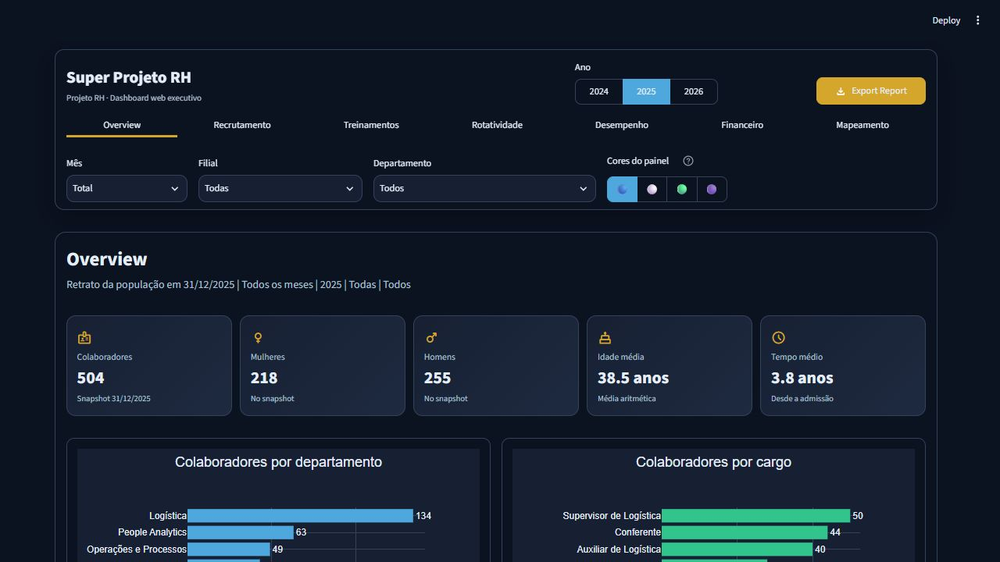

# People Analytics 360

> **Privacidade e segurança:** este projeto utiliza exclusivamente dados fictícios. Dados empresariais reais não devem ser compartilhados com ferramentas de IA públicas ou não autorizadas.

## Sobre o projeto

Este projeto integra meu portfólio de desenvolvimento em Python e People Analytics. Ele demonstra minha capacidade de estruturar, testar e publicar dashboards interativos, preparando-me para contribuir em projetos iniciais de dados, indicadores e automação com acompanhamento técnico.

O dashboard executivo de Recursos Humanos foi desenvolvido em Python e Streamlit. A aplicação reúne indicadores de quadro de pessoal, recrutamento, treinamento, rotatividade, desempenho, custos e diversidade em uma navegação única, com filtros e exportação para Excel.

## Demonstração



A URL pública será acrescentada aqui após o primeiro deploy no Streamlit Community Cloud.

## Problema de negócio

Informações de RH costumam ficar distribuídas entre cadastros, históricos mensais, processos seletivos e registros de treinamento. Isso dificulta responder rapidamente a perguntas como:

- Qual é o quadro atual e como ele evoluiu?
- Onde estão concentrados admissões e desligamentos?
- Como estão turnover, absenteísmo e desempenho?
- Quanto foi investido em pessoal e treinamento?
- Como está a composição demográfica da organização?

O projeto consolida essas fontes, valida sua estrutura e apresenta indicadores comparáveis em um painel interativo.

## Funcionalidades

- filtros por ano, mês, filial e departamento;
- sete páginas temáticas com navegação fixa;
- quatro temas visuais;
- cartões de indicadores e gráficos Plotly responsivos;
- tratamento explícito de filtros sem dados;
- exportação das informações filtradas para Excel;
- validações automatizadas do contrato das bases;
- testes do núcleo analítico e da interface Streamlit.

## Indicadores e páginas

| Página | Conteúdo principal |
|---|---|
| Overview | quadro, admissões, desligamentos, turnover e evolução mensal |
| Recrutamento | vagas, inscrições, prazo de fechamento e canais |
| Treinamentos | participantes, horas, investimento e avaliação |
| Rotatividade | entradas, saídas, motivos e recortes organizacionais |
| Desempenho | avaliações, satisfação e distribuição de resultados |
| Financeiro | salários, benefícios, rescisões e custo total de pessoal |
| Mapeamento | gênero, faixa etária, formação e demais dimensões agregadas |

## Tecnologias

- Python 3.12
- Streamlit 1.66
- Pandas e NumPy
- Plotly
- OpenPyXL
- Pytest e `streamlit.testing`

## Arquitetura

```text
.
├── .streamlit/
│   └── config.toml
├── assets/
│   └── dashboard_overview.png
├── dados/
│   ├── base_rh_colaboradores.csv
│   ├── base_rh_mensal_2024_2026.csv
│   ├── base_rh_recrutamento_2024_2026.csv
│   ├── base_rh_treinamentos_2024_2026.csv
│   └── dicionario_dados.csv
├── src/
│   ├── __init__.py
│   └── dashboard_core.py
├── tests/
│   └── test_dashboard.py
├── .gitignore
├── LICENSE
├── README.md
├── requirements-dev.txt
├── requirements.txt
└── streamlit_app.py
```

`streamlit_app.py` contém a interface. `src/dashboard_core.py` concentra carga, validação, filtros, cálculos, gráficos e exportação. Essa separação permite testar as regras sem depender do navegador.

## Dados

As cinco bases CSV necessárias ao dashboard ficam em `dados/`. Os identificadores seguem padrões fictícios como `Colaborador 0001` e `RH-00001`. O `.gitignore` bloqueia qualquer nova base colocada nessa pasta e libera somente os cinco arquivos fictícios conhecidos.

O conjunto de dados abrange os anos de 2024 e 2025 completos e o período de janeiro a setembro de 2026.

## Segurança, privacidade e uso responsável de IA

Todas as bases utilizadas neste projeto são integralmente fictícias e foram criadas exclusivamente para fins de estudo e demonstração.

Em um ambiente profissional, não devem ser enviados, anexados ou copiados para ferramentas públicas ou não autorizadas de inteligência artificial:

- dados pessoais de colaboradores ou candidatos;
- salários, avaliações, informações médicas ou demográficas;
- documentos internos e informações confidenciais;
- credenciais, senhas, tokens ou chaves de acesso;
- bases de dados, códigos ou regras de negócio protegidas pela empresa.

Ferramentas de IA somente devem ser utilizadas quando autorizadas pela organização e dentro de ambientes homologados, respeitando as políticas internas de segurança, privacidade, controle de acesso e proteção de dados.

Quando não houver autorização formal, o trabalho deve ser realizado exclusivamente com dados sintéticos ou com dados tratados por processos de anonimização aprovados pela empresa.

Assumo o compromisso de proteger as informações às quais tiver acesso e de consultar as áreas responsáveis por Segurança da Informação e Privacidade sempre que houver dúvida sobre o uso adequado dos dados.

## Desenvolvimento e aprendizado

Este projeto faz parte da minha trajetória de desenvolvimento em Python e People Analytics, combinando:

- experiência anterior com análises, indicadores e dashboards em Excel;
- conhecimentos adquiridos em cursos online de Python;
- aplicação de boas práticas de análise de dados e visualização;
- uso responsável de ferramentas de inteligência artificial como apoio ao estudo, à revisão de código, à documentação e à pesquisa de boas práticas.

A inteligência artificial foi utilizada como ferramenta de aprendizagem e suporte. O projeto foi estudado, testado e validado durante seu desenvolvimento, com foco na compreensão das regras de negócio, dos indicadores e do funcionamento do código.

## Execução local

Pré-requisito: Python 3.12.

No PowerShell, a partir da raiz do projeto:

```powershell
python -m venv .venv
.\.venv\Scripts\Activate.ps1
python -m pip install --upgrade pip
python -m pip install -r requirements.txt
python -m streamlit run streamlit_app.py
```

A aplicação ficará disponível em `http://localhost:8501`.

## Testes

```powershell
python -m pip install -r requirements-dev.txt
python -m pytest -q
```

Os testes verificam os contratos das bases, identificadores fictícios, construção das sete páginas, exportação Excel e inicialização da interface.

## Publicação com GitHub Desktop

1. Abra o GitHub Desktop e selecione **File > Add local repository**.
2. Escolha esta pasta do projeto.
3. Confira a lista de arquivos. Notebooks, históricos, ambientes e bases não autorizadas não devem aparecer.
4. Registre o primeiro commit: `Preparar dashboard para publicação`.
5. Clique em **Publish repository**.
6. Nome `people-analytics-360`.
7. Para manter o portfólio público, desmarque **Keep this code private** antes de publicar.

## Deploy no Streamlit Community Cloud

1. Acesse [share.streamlit.io](https://share.streamlit.io/) e escolha **Create app**.
2. Selecione o repositório e a branch `main`.
3. Informe `streamlit_app.py` como arquivo principal.
4. Em **Advanced settings**, selecione Python 3.12.
5. Não cadastre segredos: esta aplicação usa apenas os CSVs fictícios versionados.
6. Clique em **Deploy** e, após a validação, adicione a URL pública à seção Demonstração deste README.

## Observações principais

- separar interface e regras de negócio melhora manutenção e testes;
- indicadores de estoque e de fluxo exigem granularidades diferentes;
- contratos de dados evitam que mudanças silenciosas prejudiquem o painel;
- dados demográficos devem ser exibidos de forma agregada;
- reprodutibilidade depende de versões, estrutura e instruções de execução claras.

## Licença

Distribuído sob a licença MIT. Consulte [LICENSE](LICENSE).
