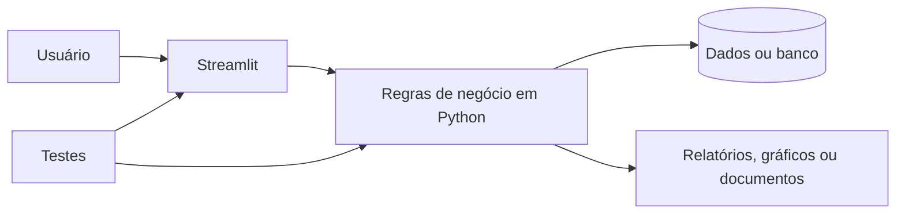

# Modelo padrão de README para projetos Python e Streamlit

> **Como usar:** copie este arquivo para o novo projeto, renomeie a cópia para `README.md`, substitua os campos entre `{{CHAVES}}` e remova as orientações que não serão publicadas. Não declare funcionalidades, testes, segurança ou resultados que ainda não tenham sido implementados e validados.

> **Versão do padrão:** 1.0 — 13/11/2026.

---

<p align="center">
  <!-- Opcional: remova quando o projeto não possuir logotipo. -->
  
</p>

<h1 align="center">{{NOME_PROJETO}}</h1>

<p align="center">
  {{DESCRICAO_CURTA_EM_UMA_FRASE}}
</p>

<p align="center">
  <a href="https://www.python.org/"></a>
  <a href="https://streamlit.io/"></a>
  
  
  <a href="LICENSE"></a>
</p>

<p align="center">
  <!-- Use somente depois da publicação. -->
  <a href="{{URL_APLICACAO}}">
    
  </a>
</p>

<p align="center">
  <a href="{{URL_APLICACAO}}">
    
  </a>
</p>

> **Projeto de portfólio:** {{DECLARACAO_SOBRE_DADOS_FICTICIOS_OU_AMBIENTE_DE_DEMONSTRACAO}}

> **Privacidade e segurança:** {{DECLARACAO_SOBRE_DADOS_REAIS_SEGREDOS_E_USO_AUTORIZADO_DE_IA}}

> **Última atualização desta documentação:** {{DD/MM/AAAA}}.

---

## Índice

1. [Visão geral](#visão-geral)
2. [O problema de negócio](#o-problema-de-negócio)
3. [A solução](#a-solução)
4. [Storytelling: antes e depois](#storytelling-antes-e-depois)
5. [Principais resultados](#principais-resultados)
6. [Evolução do projeto](#evolução-do-projeto)
7. [Funcionalidades](#funcionalidades)
8. [Arquitetura da solução](#arquitetura-da-solução)
9. [Segurança e privacidade](#segurança-e-privacidade)
10. [Stack tecnológica](#stack-tecnológica)
11. [Estrutura do repositório](#estrutura-do-repositório)
12. [Como executar localmente](#como-executar-localmente)
13. [Testes e qualidade](#testes-e-qualidade)
14. [Publicação](#publicação)
15. [Decisões técnicas](#decisões-técnicas)
16. [Limitações](#limitações)
17. [Melhorias futuras](#melhorias-futuras)
18. [Desenvolvimento e uso de IA](#desenvolvimento-e-uso-de-ia)
19. [Documentação complementar](#documentação-complementar)
20. [Autor e licença](#autor-e-licença)

---

## Visão geral

Explique em dois ou três parágrafos:

- o que o aplicativo faz;
- para quem foi criado;
- quais processos ou decisões ele apoia;
- se é portfólio, protótipo, homologação ou produção;
- onde a demonstração pode ser acessada.

**Demonstração:** [{{NOME_DO_LINK}}]({{URL_APLICACAO}})

## O problema de negócio

Descreva a situação anterior, as dificuldades e os riscos. Evite começar pela tecnologia.

### Pergunta de negócio

> {{PERGUNTA_CENTRAL_QUE_O_PROJETO_RESPONDE}}

## A solução

Explique como os dados entram, são tratados e se transformam em uma entrega útil.

```text
{{ENTRADA}}
    → {{VALIDACAO_OU_TRATAMENTO}}
    → {{REGRA_DE_NEGOCIO}}
    → {{INTERFACE_OU_DOCUMENTO}}
    → {{RESULTADO_PARA_O_USUARIO}}
```

## Storytelling: antes e depois

| Processo | Antes da solução | Com o aplicativo |
|---|---|---|
| {{PROCESSO_1}} | {{SITUACAO_ANTERIOR}} | {{MELHORIA_ENTREGUE}} |
| {{PROCESSO_2}} | {{SITUACAO_ANTERIOR}} | {{MELHORIA_ENTREGUE}} |
| {{PROCESSO_3}} | {{SITUACAO_ANTERIOR}} | {{MELHORIA_ENTREGUE}} |

## Principais resultados

Registre apenas resultados demonstráveis. Separe resultados do software de resultados reais de negócio.

- {{RESULTADO_VALIDADO_1}};
- {{RESULTADO_VALIDADO_2}};
- {{QUANTIDADE_TESTES}} testes automatizados aprovados;
- {{RESULTADO_DE_RESPONSIVIDADE_OU_SEGURANCA}}.

> {{AVISO_QUANDO_OS_NUMEROS_FOREM_FICTICIOS_OU_ILUSTRATIVOS}}

## Evolução do projeto

### {{PERIODO_OU_ETAPA}}

- {{ALTERACAO_RELEVANTE}};
- {{PROBLEMA_CORRIGIDO}};
- {{DECISAO_TECNICA}};
- {{VALIDACAO_REALIZADA}}.

## Funcionalidades

| Módulo ou recurso | Entregas principais |
|---|---|
| {{MODULO_1}} | {{ENTREGAS}} |
| {{MODULO_2}} | {{ENTREGAS}} |
| {{MODULO_3}} | {{ENTREGAS}} |

## Arquitetura da solução



### Camadas

1. **Interface:** {{RESPONSABILIDADE_DA_INTERFACE}}.
2. **Domínio:** {{CALCULOS_VALIDACOES_E_REGRAS}}.
3. **Dados:** {{CSV_BANCO_API_OU_OUTRA_FONTE}}.
4. **Qualidade:** {{TIPOS_DE_TESTE_E_VALIDACAO}}.
5. **Publicação:** {{ONDE_E_COMO_O_PROJETO_E_EXECUTADO}}.

## Segurança e privacidade

Documente somente proteções existentes:

- classificação e origem dos dados;
- separação entre demonstração e produção;
- autenticação e perfis, quando existirem;
- remoção de informações sensíveis antes de exibir ou exportar;
- segredos fora do código e do GitHub;
- limitações de uso e responsabilidades.

> Ocultar um campo na interface não remove o dado enviado ao navegador ou ao arquivo. Informações sensíveis devem ser retiradas antes da exibição ou exportação.

## Stack tecnológica

| Camada | Tecnologia |
|---|---|
| Linguagem | Python {{VERSAO_PYTHON}} |
| Interface | Streamlit {{VERSAO_STREAMLIT}} |
| Dados | {{PANDAS_BANCO_API}} |
| Gráficos | {{BIBLIOTECA_GRAFICOS}} |
| Documentos | {{PDF_EXCEL_CSV_OU_NAO_SE_APLICA}} |
| Testes | pytest e `streamlit.testing.v1.AppTest` |
| Versionamento | Git, GitHub e GitHub Desktop |
| Publicação | {{STREAMLIT_CLOUD_DOCKER_OUTRO}} |

## Estrutura do repositório

Liste somente arquivos realmente versionados.

```text
{{SLUG_PROJETO}}/
├── .streamlit/
│   └── config.toml
├── app_pages/                    # Remova quando não existir
├── assets/
├── dados/                        # Ou data/, conforme o projeto
├── docs/
├── src/
├── tests/
├── .gitignore
├── LICENSE
├── README.md
├── requirements-dev.txt
├── requirements.txt
└── streamlit_app.py
```

## Como executar localmente

### Pré-requisitos

- Python {{VERSAO_PYTHON}};
- Git;
- navegador atualizado;
- {{OUTRO_REQUISITO_OU_REMOVER}}.

### 1. Clone o repositório

```powershell
git clone {{URL_REPOSITORIO_GIT}}
cd {{SLUG_PROJETO}}
```

### 2. Crie o ambiente virtual

```powershell
py -{{VERSAO_PYTHON}} -m venv .venv
```

### 3. Instale as dependências

```powershell
.\.venv\Scripts\python.exe -m pip install --upgrade pip
.\.venv\Scripts\python.exe -m pip install -r requirements.txt
```

Para desenvolvimento e testes:

```powershell
.\.venv\Scripts\python.exe -m pip install -r requirements-dev.txt
```

### 4. Configure segredos, quando necessário

Nunca publique valores reais. Mostre somente nomes e exemplos falsos em `.streamlit/secrets.toml.example`.

### 5. Abra o aplicativo

```powershell
.\.venv\Scripts\python.exe -m streamlit run streamlit_app.py
```

## Testes e qualidade

```powershell
.\.venv\Scripts\python.exe -m pytest -q -p no:cacheprovider
```

Situação validada em {{DD/MM/AAAA}}:

```text
{{QUANTIDADE_TESTES}} passed
```

Explique o que os testes protegem. Não atualize o badge ou a contagem sem executar a suíte completa.

## Publicação

| Campo | Valor |
|---|---|
| Repositório | `{{USUARIO_OU_ORGANIZACAO}}/{{REPOSITORIO}}` |
| Branch | `main` |
| Arquivo principal | `streamlit_app.py` |
| Python | `{{VERSAO_PYTHON}}` |
| Segredos | {{SEGREDOS_NECESSARIOS_OU_NENHUM}} |
| URL | [{{DOMINIO_EXIBIDO}}]({{URL_APLICACAO}}) |

```text
Alteração local → testes → revisão → commit → Push origin
    → GitHub main → implantação ou redeploy → validação pós-publicação
```

## Decisões técnicas

- **{{DECISAO_1}}:** {{MOTIVO_E_BENEFICIO}}.
- **{{DECISAO_2}}:** {{MOTIVO_E_BENEFICIO}}.
- **{{DECISAO_3}}:** {{MOTIVO_E_BENEFICIO}}.

## Limitações

- {{LIMITACAO_REAL_1}};
- {{LIMITACAO_REAL_2}};
- {{RISCO_OU_DEPENDENCIA_EXTERNA}};
- {{O_QUE_AINDA_NAO_FOI_IMPLEMENTADO}}.

## Melhorias futuras

- {{MELHORIA_PRIORIZADA_1}};
- {{MELHORIA_PRIORIZADA_2}};
- {{MELHORIA_PRIORIZADA_3}}.

## Desenvolvimento e uso de IA

Descreva com transparência a experiência anterior aplicada, os cursos realizados, como a IA apoiou o estudo e quais regras de segurança seriam seguidas em uma empresa.

Texto-base:

> Ferramentas de IA foram utilizadas como apoio ao estudo, à revisão e à documentação. As decisões, as regras de negócio e os resultados foram compreendidos e validados durante o desenvolvimento. Dados empresariais reais, credenciais e documentos protegidos não devem ser enviados a ferramentas públicas ou não autorizadas.

## Documentação complementar

| Documento | Conteúdo |
|---|---|
| [`{{ARQUIVO_1}}`]({{CAMINHO_1}}) | {{DESCRICAO_1}} |
| [`{{ARQUIVO_2}}`]({{CAMINHO_2}}) | {{DESCRICAO_2}} |

## Autor e licença

Projeto desenvolvido por **{{NOME_AUTOR}}** como parte de {{CONTEXTO_PROFISSIONAL_OU_ACADEMICO}}.

- GitHub: [@{{USUARIO_GITHUB}}](https://github.com/{{USUARIO_GITHUB}})
- Repositório: [{{NOME_REPOSITORIO}}]({{URL_REPOSITORIO}})
- Aplicação: [{{NOME_PROJETO}}]({{URL_APLICACAO}})

{{DECLARACAO_DE_LICENCA}} Consulte [`LICENSE`](LICENSE).

---

## Checklist antes de publicar o README

- [ ] Todos os campos `{{CHAVES}}` foram substituídos.
- [ ] O nome, a descrição e a imagem correspondem ao projeto atual.
- [ ] Os badges usam versões e contagens confirmadas.
- [ ] O link da demonstração abre sem solicitar acesso indevido.
- [ ] A árvore contém somente arquivos realmente versionados.
- [ ] Os comandos foram testados em um ambiente limpo.
- [ ] A suíte completa foi executada e a contagem está atualizada.
- [ ] Resultados fictícios estão identificados como demonstrativos.
- [ ] Nenhum segredo, dado pessoal ou caminho local foi publicado.
- [ ] Limitações e funcionalidades futuras não foram apresentadas como prontas.
- [ ] O uso de IA está descrito com transparência e responsabilidade.
- [ ] O texto foi revisado em computador e celular.
